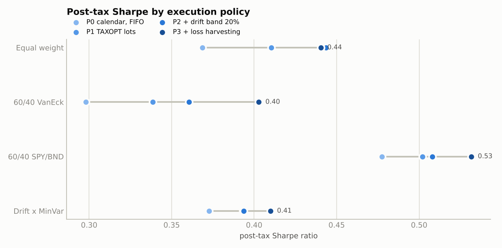
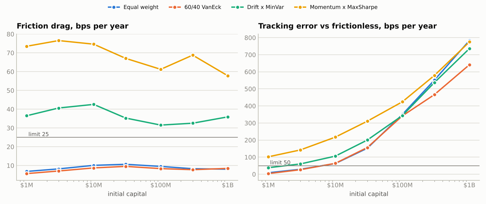

# Pre-registered extensions - generated report

Window 2017-06-01 to 2024-12-31; rules in docs/SPEC.md sections 14-16. Narrative in EXTENSIONS_FINDINGS.md.

## Extension 1 - tax-aware execution (SPEC s.14)

**Gate 1 verdict under any policy: unchanged (fail)**

| policy | ew_sharpe_post | benchmark_sharpe_post | margin | threshold | gate1_pass |
|---|---|---|---|---|---|
| P0 calendar, FIFO | 0.369 | 0.298 | 0.071 | 0.200 | no |
| P1 TAXOPT lots | 0.410 | 0.339 | 0.072 | 0.200 | no |
| P2 + drift band 20% | 0.443 | 0.360 | 0.083 | 0.200 | no |
| P3 + loss harvesting | 0.440 | 0.403 | 0.038 | 0.200 | no |

Policy ladder (pre- and post-tax, same OOS window; tracking error is against the same portfolio under P0, pre-tax):

| portfolio | policy | cagr_pre | cagr_post | sharpe_pre | sharpe_post | mdd_post | turnover_pre | cost_bps_yr | tax_pct_yr | harvests | tracking_error_vs_p0_pre | sharpe_post_gain_vs_p0 |
|---|---|---|---|---|---|---|---|---|---|---|---|---|
| Equal weight | P0 calendar, FIFO | 9.9% | 6.9% | 0.554 | 0.369 | -28.6% | 20.9% | 3.932 | 2.544 | 0 | 0.0% | 0.000 |
| Equal weight | P1 TAXOPT lots | 9.9% | 7.5% | 0.554 | 0.410 | -28.6% | 20.9% | 3.932 | 1.854 | 0 | 0.0% | 0.042 |
| Equal weight | P2 + drift band 20% | 9.7% | 8.0% | 0.546 | 0.443 | -27.9% | 5.5% | 1.773 | 1.530 | 0 | 0.7% | 0.075 |
| Equal weight | P3 + loss harvesting | 9.4% | 8.0% | 0.533 | 0.440 | -28.6% | 30.9% | 4.931 | 0.990 | 40 | 1.4% | 0.072 |
| 60/40 VanEck | P0 calendar, FIFO | 8.4% | 5.6% | 0.489 | 0.298 | -25.3% | 22.2% | 2.909 | 2.489 | 0 | 0.0% | 0.000 |
| 60/40 VanEck | P1 TAXOPT lots | 8.4% | 6.2% | 0.489 | 0.339 | -23.8% | 22.2% | 2.909 | 1.832 | 0 | 0.0% | 0.040 |
| 60/40 VanEck | P2 + drift band 20% | 8.5% | 6.4% | 0.500 | 0.360 | -23.9% | 6.8% | 1.375 | 1.554 | 0 | 0.8% | 0.062 |
| 60/40 VanEck | P3 + loss harvesting | 7.8% | 7.0% | 0.452 | 0.403 | -23.1% | 32.6% | 3.996 | 1.048 | 30 | 1.5% | 0.105 |
| 60/40 SPY/BND | P0 calendar, FIFO | 9.2% | 7.4% | 0.617 | 0.477 | -22.1% | 10.7% | 0.563 | 1.343 | 0 | 0.0% | 0.000 |
| 60/40 SPY/BND | P1 TAXOPT lots | 9.2% | 7.7% | 0.617 | 0.502 | -21.7% | 10.7% | 0.563 | 1.074 | 0 | 0.0% | 0.025 |
| 60/40 SPY/BND | P2 + drift band 20% | 9.5% | 8.2% | 0.625 | 0.508 | -23.3% | 1.6% | 0.255 | 0.923 | 0 | 0.8% | 0.031 |
| 60/40 SPY/BND | P3 + loss harvesting | 9.5% | 8.4% | 0.625 | 0.532 | -23.3% | 13.8% | 0.715 | 0.914 | 5 | 0.8% | 0.054 |
| Drift x MinVar | P0 calendar, FIFO | 11.0% | 6.8% | 0.652 | 0.373 | -27.3% | 106.0% | 16.876 | 3.349 | 0 | 0.0% | 0.000 |
| Drift x MinVar | P1 TAXOPT lots | 11.0% | 7.1% | 0.652 | 0.393 | -27.4% | 106.0% | 16.876 | 2.972 | 0 | 0.0% | 0.021 |
| Drift x MinVar | P2 + drift band 20% | 10.7% | 7.1% | 0.636 | 0.394 | -27.4% | 90.7% | 14.548 | 2.754 | 0 | 0.5% | 0.021 |
| Drift x MinVar | P3 + loss harvesting | 9.6% | 7.4% | 0.569 | 0.410 | -27.5% | 135.0% | 17.488 | 2.660 | 63 | 2.5% | 0.037 |

Sensitivities:

| variant | portfolio | policy | sharpe_post | cagr_post | tax_pct_yr |
|---|---|---|---|---|---|
| short-term gains taxed at 46% | Equal weight | P0 calendar, FIFO | 0.367 | 6.9% | 2.568 |
| short-term gains taxed at 46% | Equal weight | P3 + loss harvesting | 0.440 | 8.0% | 0.999 |
| short-term gains taxed at 46% | 60/40 VanEck | P0 calendar, FIFO | 0.296 | 5.5% | 2.516 |
| short-term gains taxed at 46% | 60/40 VanEck | P3 + loss harvesting | 0.402 | 7.0% | 1.062 |
| harvesting without OUNZ/IAU | Equal weight | P0 calendar, FIFO | 0.369 | 6.9% | 2.544 |
| harvesting without OUNZ/IAU | Equal weight | P3 without OUNZ/IAU pair | 0.434 | 7.9% | 1.051 |
| harvesting without OUNZ/IAU | 60/40 VanEck | P0 calendar, FIFO | 0.298 | 5.6% | 2.489 |
| harvesting without OUNZ/IAU | 60/40 VanEck | P3 without OUNZ/IAU pair | 0.403 | 7.0% | 1.048 |

## Extension 2 - statistical design (SPEC s.15)

Benchmark 60/40 VanEck (60% EW equity funds / 40% BND); months 2017-07-31 to 2024-12-31; Bonferroni alpha 0.0083; bootstrap 2000 draws, block 6.

### A. Power: minimum detectable annual excess return at 80% power (annual test, n = 7) and the monthly equivalent

|  | family | n_years | mean_annual_excess | sd_annual | mde_annual_bonferroni | mde_annual_alpha05 | years_needed_for_observed_effect | mde_monthly_bonferroni_x12 | mde_monthly_alpha05_x12 |
|---|---|---|---|---|---|---|---|---|---|
| NonexMinVar+Regime | primary | 7 | -1.8% | 8.8% | 14.4% | 9.4% | None | 11.2% | 8.5% |
| NonexMaxSharpe+Regime | primary | 7 | -3.3% | 6.4% | 10.4% | 6.8% | None | 11.2% | 8.6% |
| MomentumxMinVar+Regime | primary | 7 | -3.3% | 6.5% | 10.6% | 7.0% | None | 11.2% | 8.5% |
| MomentumxMaxSharpe+Regime | primary | 7 | -3.4% | 6.4% | 10.4% | 6.8% | None | 11.2% | 8.5% |
| DriftxMinVar+Regime | primary | 7 | -1.5% | 6.7% | 10.9% | 7.2% | None | 10.5% | 8.0% |
| DriftxMaxSharpe+Regime | primary | 7 | -1.6% | 6.7% | 10.8% | 7.1% | None | 10.4% | 7.9% |
| NonexMinVar | diagnostic | 7 | -0.0% | 5.5% | 9.0% | 5.9% | None | 6.4% | 4.9% |
| NonexMaxSharpe | diagnostic | 7 | -1.2% | 4.1% | 6.6% | 4.3% | None | 6.8% | 5.2% |
| MomentumxMinVar | diagnostic | 7 | -0.6% | 3.6% | 5.8% | 3.8% | None | 6.1% | 4.6% |
| MomentumxMaxSharpe | diagnostic | 7 | -0.7% | 3.2% | 5.3% | 3.5% | None | 6.2% | 4.8% |
| DriftxMinVar | diagnostic | 7 | 1.4% | 4.0% | 6.5% | 4.2% | 85 | 4.0% | 3.0% |
| DriftxMaxSharpe | diagnostic | 7 | 1.4% | 3.5% | 5.6% | 3.7% | 65 | 4.0% | 3.1% |

### B. Monthly paired test with Newey-West standard errors

|  | family | mean_monthly_excess_x12 | se_hac_x12 | lags | t_hac | p_hac_one_sided | p_plain_one_sided |
|---|---|---|---|---|---|---|---|
| NonexMinVar+Regime | primary | -2.5% | 3.0% | 3 | -0.826 | 0.794 | 0.766 |
| NonexMaxSharpe+Regime | primary | -3.0% | 2.8% | 3 | -1.085 | 0.860 | 0.811 |
| MomentumxMinVar+Regime | primary | -2.8% | 2.7% | 3 | -1.053 | 0.852 | 0.795 |
| MomentumxMaxSharpe+Regime | primary | -3.0% | 2.7% | 3 | -1.122 | 0.868 | 0.808 |
| DriftxMinVar+Regime | primary | -1.6% | 2.7% | 3 | -0.579 | 0.718 | 0.687 |
| DriftxMaxSharpe+Regime | primary | -1.7% | 2.6% | 3 | -0.631 | 0.735 | 0.701 |
| NonexMinVar | diagnostic | -0.8% | 1.6% | 3 | -0.525 | 0.699 | 0.667 |
| NonexMaxSharpe | diagnostic | -1.0% | 1.6% | 3 | -0.645 | 0.740 | 0.694 |
| MomentumxMinVar | diagnostic | -0.3% | 1.6% | 3 | -0.159 | 0.563 | 0.555 |
| MomentumxMaxSharpe | diagnostic | -0.3% | 1.7% | 3 | -0.177 | 0.570 | 0.561 |
| DriftxMinVar | diagnostic | 1.2% | 1.1% | 3 | 1.072 | 0.143 | 0.162 |
| DriftxMaxSharpe | diagnostic | 1.3% | 1.1% | 3 | 1.139 | 0.129 | 0.152 |

### C. Probabilistic and deflated Sharpe ratios (monthly excess returns over cash)

Primary family, N = 6 trials:

|  | sr_annualised | skew | kurt | psr_vs_zero | sr0_expected_max | deflated_sr |
|---|---|---|---|---|---|---|
| NonexMinVar+Regime | 0.217 | 0.850 | 4.453 | 0.727 | 0.024 | 0.644 |
| NonexMaxSharpe+Regime | 0.119 | 0.242 | 3.115 | 0.627 | 0.024 | 0.538 |
| MomentumxMinVar+Regime | 0.131 | 0.187 | 2.748 | 0.640 | 0.024 | 0.551 |
| MomentumxMaxSharpe+Regime | 0.116 | 0.163 | 2.759 | 0.625 | 0.024 | 0.535 |
| DriftxMinVar+Regime | 0.254 | 0.335 | 2.870 | 0.758 | 0.024 | 0.680 |
| DriftxMaxSharpe+Regime | 0.242 | 0.311 | 2.855 | 0.747 | 0.024 | 0.668 |

All 12 (with the edge series versus 60/40):

|  | sr_annualised | skew | kurt | psr_vs_zero | sr0_expected_max | deflated_sr | edge_sr_annualised | psr_edge_vs_zero |
|---|---|---|---|---|---|---|---|---|
| NonexMinVar+Regime | 0.217 | 0.850 | 4.453 | 0.727 | 0.046 | 0.563 | -0.266 | 0.229 |
| NonexMaxSharpe+Regime | 0.119 | 0.242 | 3.115 | 0.627 | 0.046 | 0.455 | -0.323 | 0.182 |
| MomentumxMinVar+Regime | 0.131 | 0.187 | 2.748 | 0.640 | 0.046 | 0.468 | -0.302 | 0.198 |
| MomentumxMaxSharpe+Regime | 0.116 | 0.163 | 2.759 | 0.625 | 0.046 | 0.453 | -0.319 | 0.184 |
| DriftxMinVar+Regime | 0.254 | 0.335 | 2.870 | 0.758 | 0.046 | 0.602 | -0.179 | 0.308 |
| DriftxMaxSharpe+Regime | 0.242 | 0.311 | 2.855 | 0.747 | 0.046 | 0.589 | -0.193 | 0.293 |
| NonexMinVar | 0.331 | -0.049 | 5.010 | 0.814 | 0.046 | 0.678 | -0.158 | 0.333 |
| NonexMaxSharpe | 0.254 | 0.023 | 3.147 | 0.755 | 0.046 | 0.600 | -0.186 | 0.305 |
| MomentumxMinVar | 0.295 | -0.042 | 2.655 | 0.788 | 0.046 | 0.643 | -0.050 | 0.445 |
| MomentumxMaxSharpe | 0.289 | -0.040 | 2.636 | 0.784 | 0.046 | 0.637 | -0.057 | 0.439 |
| DriftxMinVar | 0.392 | 0.130 | 3.718 | 0.858 | 0.046 | 0.737 | 0.361 | 0.842 |
| DriftxMaxSharpe | 0.395 | 0.085 | 3.616 | 0.859 | 0.046 | 0.739 | 0.377 | 0.848 |

### D. Romano-Wolf stepdown (one-sided, alpha 0.05)

Primary family: White reality-check p = 0.809

|  | mean_diff | t | p_raw_bootstrap | p_adjusted_stepdown | reject_at_alpha |
|---|---|---|---|---|---|
| DriftxMinVar+Regime | -0.1% | -0.490 | 0.720 | 0.809 | no |
| DriftxMaxSharpe+Regime | -0.1% | -0.528 | 0.743 | 0.822 | no |
| NonexMinVar+Regime | -0.2% | -0.727 | 0.790 | 0.877 | no |
| MomentumxMinVar+Regime | -0.2% | -0.827 | 0.870 | 0.886 | no |
| MomentumxMaxSharpe+Regime | -0.2% | -0.874 | 0.887 | 0.895 | no |
| NonexMaxSharpe+Regime | -0.3% | -0.885 | 0.868 | 0.895 | no |

All 12: White reality-check p = 0.359

|  | mean_diff | t | p_raw_bootstrap | p_adjusted_stepdown | reject_at_alpha |
|---|---|---|---|---|---|
| DriftxMaxSharpe | 0.1% | 1.032 | 0.120 | 0.359 | no |
| DriftxMinVar | 0.1% | 0.990 | 0.133 | 0.366 | no |
| MomentumxMinVar | -0.0% | -0.138 | 0.584 | 0.898 | no |
| MomentumxMaxSharpe | -0.0% | -0.155 | 0.597 | 0.901 | no |
| NonexMinVar | -0.1% | -0.433 | 0.703 | 0.902 | no |
| DriftxMinVar+Regime | -0.1% | -0.490 | 0.720 | 0.902 | no |
| NonexMaxSharpe | -0.1% | -0.509 | 0.776 | 0.902 | no |
| DriftxMaxSharpe+Regime | -0.1% | -0.528 | 0.743 | 0.902 | no |
| NonexMinVar+Regime | -0.2% | -0.727 | 0.790 | 0.902 | no |
| MomentumxMinVar+Regime | -0.2% | -0.827 | 0.870 | 0.902 | no |
| MomentumxMaxSharpe+Regime | -0.2% | -0.874 | 0.887 | 0.902 | no |
| NonexMaxSharpe+Regime | -0.3% | -0.885 | 0.868 | 0.902 | no |

## Extension 3 - liquidity and capacity (SPEC s.16)

Square-root impact (coefficient 1.0) plus the 10% participation cap, pre-tax; capacity = largest AUM with drag <= 25 bps/yr and tracking error <= 50 bps/yr against the frictionless, uncapped run.

| portfolio | capacity_aum | drag_limit_bps | te_limit_bps | binding |
|---|---|---|---|---|
| Equal weight | 3M | 25 | 50 | tracking |
| 60/40 VanEck | 3M | 25 | 50 | tracking |
| Drift x MinVar | below 1M | 25 | 50 | drag+tracking |
| Momentum x MaxSharpe | below 1M | 25 | 50 | drag+tracking |

| portfolio | aum | drag_bps_yr | tracking_error_bps_yr | cum_shortfall | cagr | turnover_pre | capped_trade_share |
|---|---|---|---|---|---|---|---|
| Equal weight | 1M | 6.858 | 8.501 | -0.7% | 9.8% | 21.5% | 0.6% |
| Equal weight | 3M | 8.220 | 28.884 | -3.8% | 9.6% | 22.7% | 2.4% |
| Equal weight | 10M | 10.100 | 62.747 | -11.4% | 9.1% | 23.2% | 10.6% |
| Equal weight | 30M | 10.655 | 152.395 | -21.0% | 8.3% | 21.5% | 22.7% |
| Equal weight | 100M | 9.536 | 350.023 | -23.4% | 8.1% | 18.0% | 43.1% |
| Equal weight | 300M | 8.303 | 551.193 | -32.6% | 7.4% | 14.8% | 59.5% |
| Equal weight | 1,000M | 8.057 | 782.871 | -41.8% | 6.6% | 11.8% | 71.7% |
| 60/40 VanEck | 1M | 5.712 | 3.718 | -0.7% | 8.3% | 22.4% | 0.5% |
| 60/40 VanEck | 3M | 7.097 | 26.367 | -3.7% | 8.1% | 22.9% | 2.2% |
| 60/40 VanEck | 10M | 8.735 | 63.891 | -10.7% | 7.5% | 22.8% | 11.5% |
| 60/40 VanEck | 30M | 9.546 | 156.501 | -19.4% | 6.8% | 21.1% | 22.2% |
| 60/40 VanEck | 100M | 8.361 | 341.798 | -17.6% | 7.0% | 19.3% | 33.5% |
| 60/40 VanEck | 300M | 7.795 | 466.075 | -25.7% | 6.3% | 18.0% | 41.0% |
| 60/40 VanEck | 1,000M | 8.467 | 641.094 | -27.6% | 6.1% | 15.7% | 51.3% |
| Drift x MinVar | 1M | 36.061 | 37.922 | -8.8% | 10.6% | 102.4% | 4.2% |
| Drift x MinVar | 3M | 39.996 | 60.034 | -11.0% | 10.4% | 96.7% | 9.5% |
| Drift x MinVar | 10M | 42.465 | 105.569 | -16.6% | 10.1% | 86.6% | 21.6% |
| Drift x MinVar | 30M | 35.362 | 199.393 | -24.0% | 9.5% | 70.1% | 34.4% |
| Drift x MinVar | 100M | 31.518 | 343.005 | -32.4% | 8.9% | 54.8% | 55.1% |
| Drift x MinVar | 300M | 32.513 | 536.261 | -44.8% | 7.9% | 43.1% | 69.2% |
| Drift x MinVar | 1,000M | 35.870 | 735.523 | -64.6% | 6.3% | 32.5% | 76.7% |
| Momentum x MaxSharpe | 1M | 73.511 | 102.060 | -16.5% | 7.7% | 218.6% | 7.2% |
| Momentum x MaxSharpe | 3M | 76.538 | 142.169 | -16.6% | 7.7% | 199.6% | 15.1% |
| Momentum x MaxSharpe | 10M | 74.617 | 217.401 | -25.8% | 6.9% | 167.8% | 28.7% |
| Momentum x MaxSharpe | 30M | 67.063 | 310.710 | -34.1% | 6.2% | 130.6% | 45.9% |
| Momentum x MaxSharpe | 100M | 61.224 | 424.227 | -39.3% | 5.7% | 96.8% | 64.6% |
| Momentum x MaxSharpe | 300M | 68.781 | 578.412 | -40.4% | 5.6% | 75.2% | 74.1% |
| Momentum x MaxSharpe | 1,000M | 57.810 | 774.881 | -45.7% | 5.1% | 48.6% | 83.9% |

