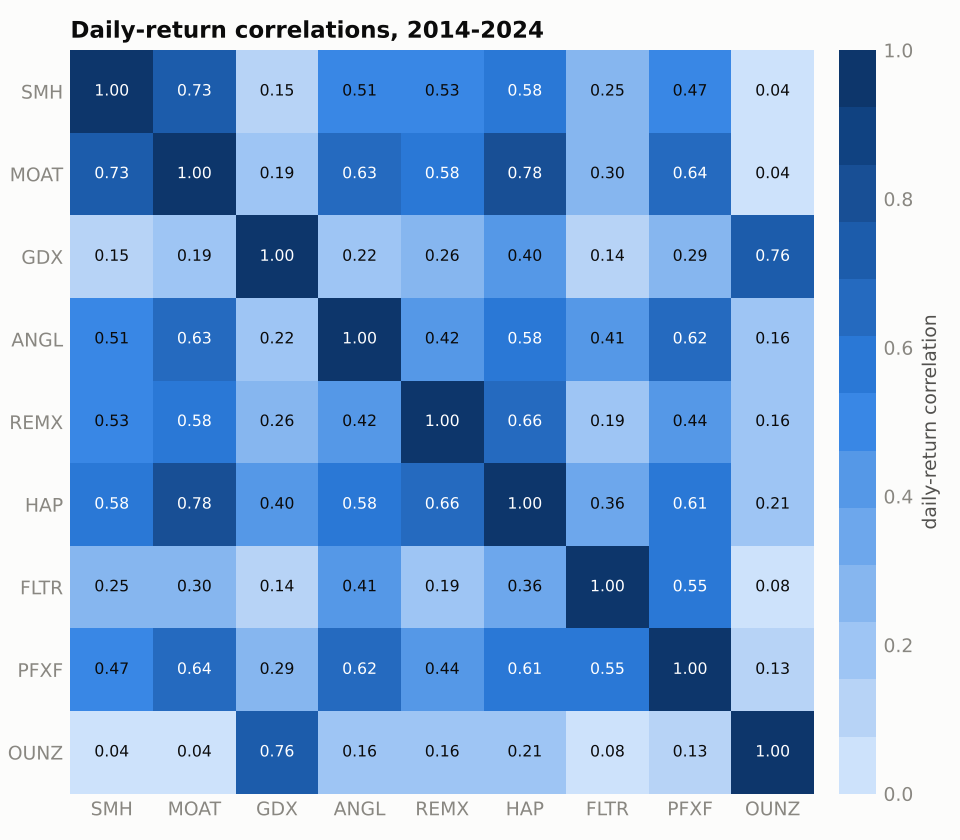
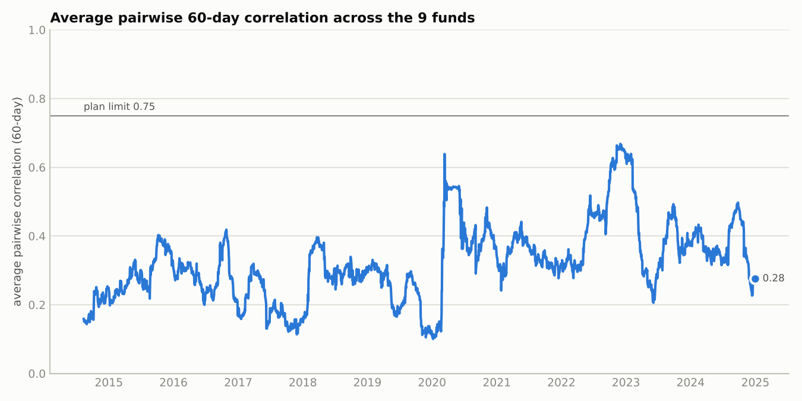
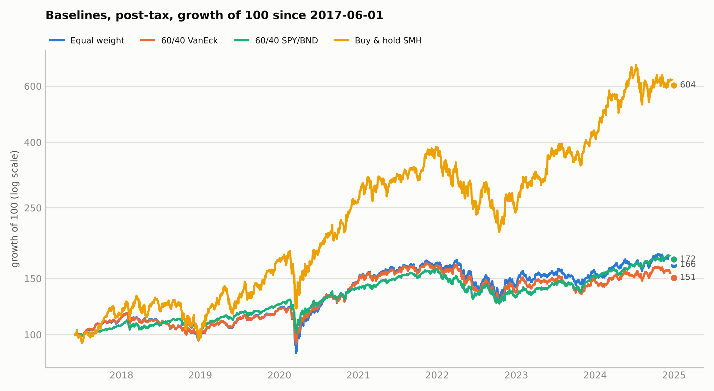
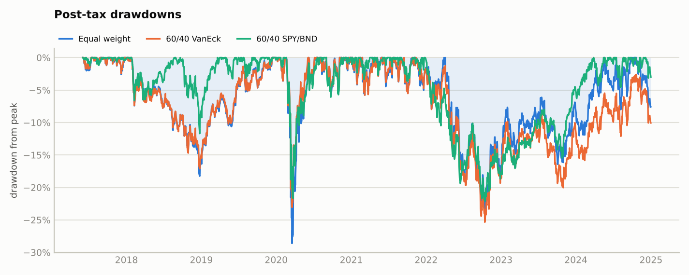
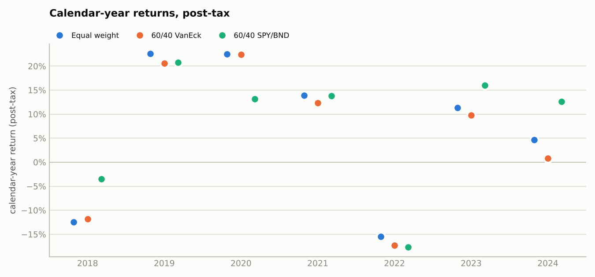
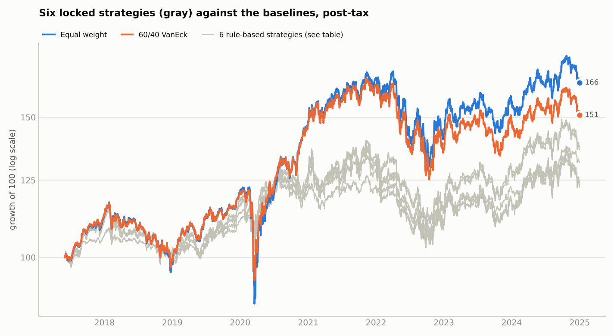
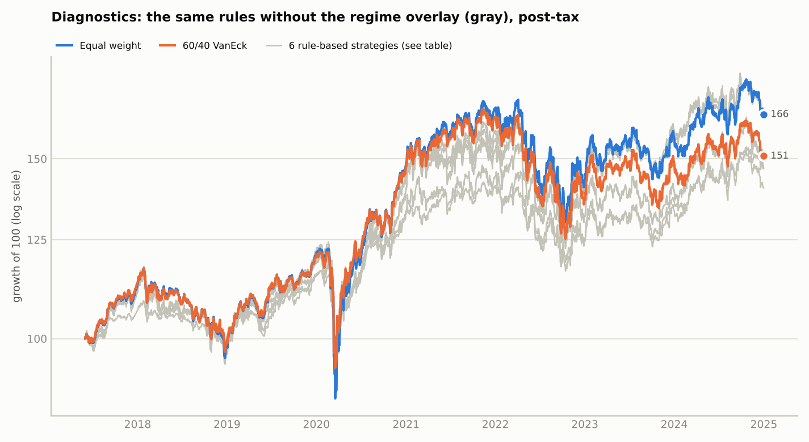
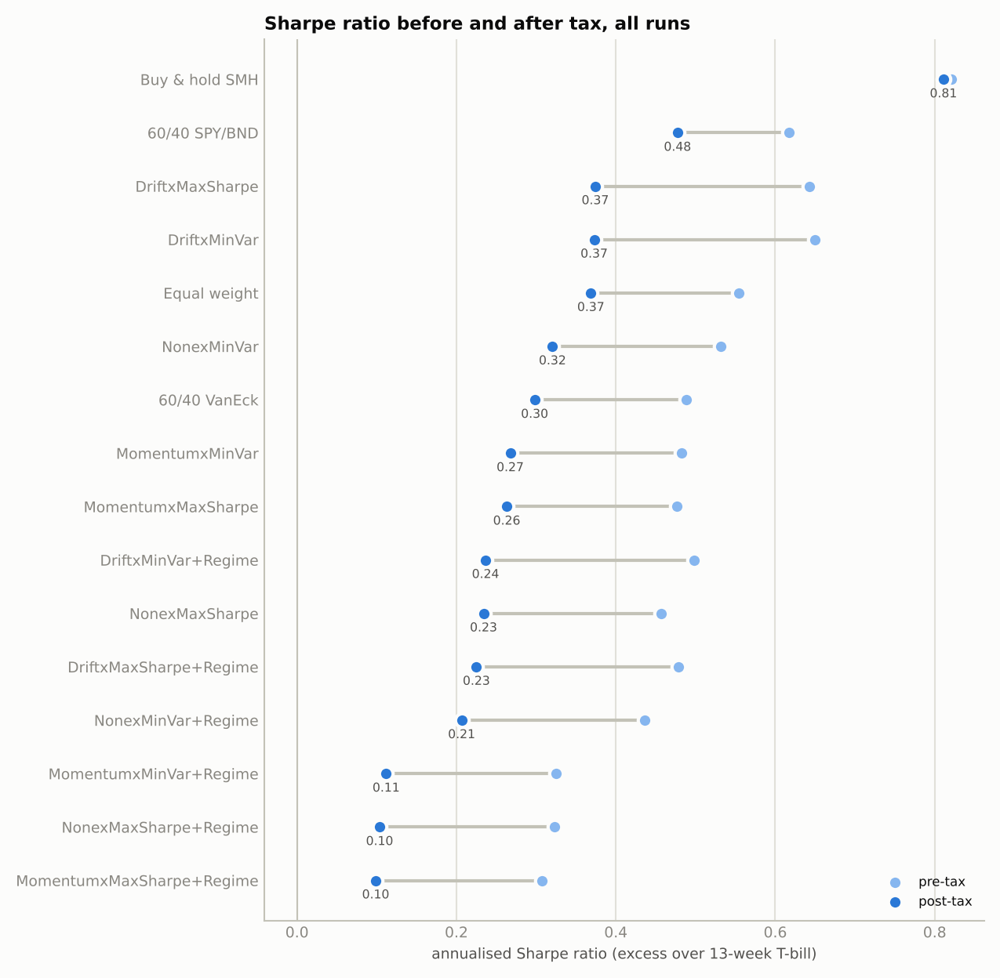
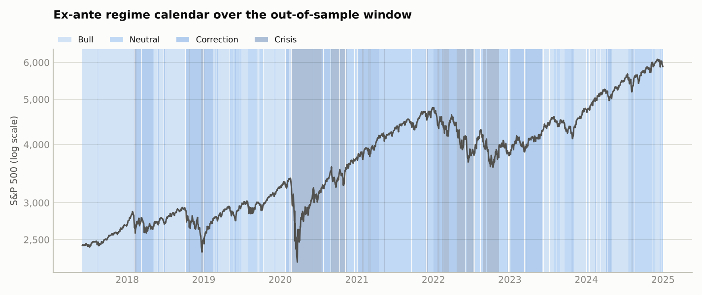
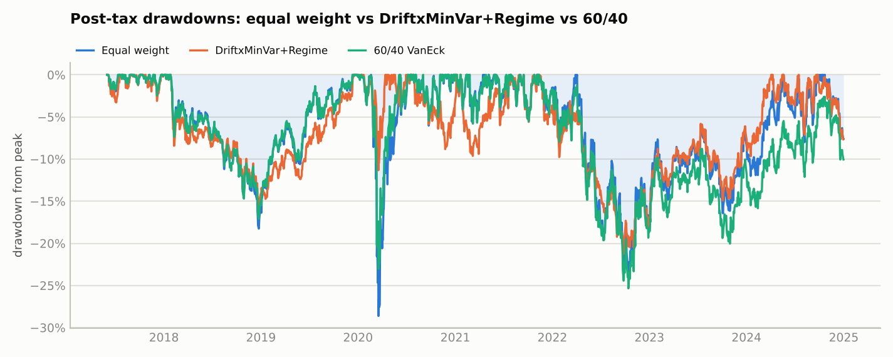

# VanEck allocation study - generated report

Data through 2026-11-06; OOS window 2017-06-01 to 2024-12-31; 91 monthly rebalances; cash/risk-free = 13-week T-bill; taxes 37% FIFO; costs tiered by dollar volume. See docs/SPEC.md for every locked rule.

## Gate 0 - is the universe allocatable?

**Verdict: PASS**

|  | value | threshold | ok |
|---|---|---|---|
| avg_pairwise_corr < 0.75 | 0.391 | 0.750 | yes |
| n_themes >= 5 (rho cut 0.60) | 5 | 5 | yes |
| no pair > 0.95 | 0.775 | 0.950 | yes |

Themes (average-linkage clusters at rho >= 0.60):

| ticker | cluster | theme |
|---|---|---|
| GDX | 1 | gold miners |
| OUNZ | 1 | gold bullion |
| ANGL | 2 | fallen-angel high yield |
| PFXF | 2 | preferred securities |
| HAP | 3 | natural resources equity |
| MOAT | 3 | US quality equity |
| SMH | 3 | semiconductors |
| REMX | 4 | rare earths / strategic metals |
| FLTR | 5 | floating-rate notes |

Highest pairwise correlation: MOAT/HAP = 0.775. Rolling 60-day average pairwise correlation: mean 0.32, max 0.67, share of days above 0.75: 0.0%.

## Gate 1 - baselines and feasibility

**Verdict: FAIL** (decisive criteria only)

|  | value | threshold | ok | decisive |
|---|---|---|---|---|
| EW post-tax Sharpe >= 60/40 (plan def.) + 0.20 | 0.071 | 0.200 | no | yes |
| EW post-tax Sharpe >= 60/40 classic + 0.20 (reference) | -0.109 | 0.200 | no | no |
| EW max drawdown not worse than -40% | -0.286 | -0.400 | yes | yes |
| EW one-way turnover < 15%/yr | 0.209 | 0.150 | no | yes |
| EW post-tax Sharpe >= 0.30 | 0.369 | 0.300 | yes | yes |
| Tax model matters: |Sharpe haircut| > 20% | 0.335 | 0.200 | yes | no |

Baseline performance, OOS window 2017-06-01 to 2024-12-31 (costs in bps of NAV per year, taxes in % of NAV per year):

| name | cagr_pre | cagr_post | vol_post | sharpe_pre | sharpe_post | mdd_post | turnover_pre | cost_bps_yr | tax_pct_yr |
|---|---|---|---|---|---|---|---|---|---|
| Equal weight | 9.9% | 6.9% | 15.2% | 0.554 | 0.369 | -28.6% | 20.9% | 3.932 | 2.544 |
| 60/40 VanEck | 8.4% | 5.6% | 14.1% | 0.489 | 0.298 | -25.3% | 22.2% | 2.909 | 2.489 |
| 60/40 SPY/BND | 9.2% | 7.4% | 11.8% | 0.617 | 0.477 | -22.1% | 10.7% | 0.563 | 1.343 |
| Buy & hold SMH | 26.9% | 26.8% | 33.5% | 0.821 | 0.811 | -45.7% | 0.0% | 0.122 | 0.000 |

Calendar-year returns, post-tax (full years only):

| year | Equal weight | 60/40 VanEck | 60/40 SPY/BND | Buy & hold SMH |
|---|---|---|---|---|
| 2018 | -12.4% | -11.8% | -3.5% | -9.7% |
| 2019 | 22.6% | 20.6% | 20.7% | 64.4% |
| 2020 | 22.5% | 22.4% | 13.2% | 55.9% |
| 2021 | 13.9% | 12.3% | 13.8% | 42.3% |
| 2022 | -15.4% | -17.3% | -17.6% | -34.1% |
| 2023 | 11.3% | 9.8% | 16.0% | 74.4% |
| 2024 | 4.6% | 0.8% | 12.6% | 39.4% |

## Phase 2 - six locked allocation rules (informational: Gate 1 failed, run with --force)

**Gate 2 verdict: FAIL** - strategies significant at Bonferroni alpha 0.0083 (post-tax, annual paired one-sided t vs 60/40 VanEck): none

### Performance, primary strategies (regime overlay applied)

| name | cagr_pre | cagr_post | vol_post | sharpe_pre | sharpe_post | mdd_post | turnover_pre | cost_bps_yr | tax_pct_yr |
|---|---|---|---|---|---|---|---|---|---|
| NonexMinVar+Regime | 5.7% | 3.7% | 8.7% | 0.436 | 0.207 | -19.2% | 144.0% | 21.310 | 1.782 |
| NonexMaxSharpe+Regime | 5.3% | 2.8% | 11.2% | 0.323 | 0.104 | -23.1% | 267.2% | 41.716 | 2.383 |
| MomentumxMinVar+Regime | 5.5% | 2.9% | 12.1% | 0.325 | 0.112 | -23.2% | 267.9% | 41.414 | 2.571 |
| MomentumxMaxSharpe+Regime | 5.3% | 2.7% | 12.2% | 0.307 | 0.099 | -23.5% | 277.8% | 43.484 | 2.530 |
| DriftxMinVar+Regime | 7.2% | 4.3% | 11.0% | 0.498 | 0.237 | -21.3% | 198.6% | 30.869 | 2.575 |
| DriftxMaxSharpe+Regime | 7.1% | 4.2% | 11.1% | 0.479 | 0.225 | -22.2% | 204.0% | 32.224 | 2.605 |

### Pre-registered test: post-tax annual returns vs 60/40 VanEck

|  | n_years | mean_annual_excess | t_annual | p_one_sided | p_monthly_paired | sharpe_diff | p_bootstrap_sharpe | significant |
|---|---|---|---|---|---|---|---|---|
| NonexMinVar+Regime | 7 | -0.018 | -0.535 | 0.694 | 0.766 | -0.092 | 0.664 | no |
| NonexMaxSharpe+Regime | 7 | -0.033 | -1.352 | 0.887 | 0.811 | -0.194 | 0.783 | no |
| MomentumxMinVar+Regime | 7 | -0.033 | -1.338 | 0.885 | 0.795 | -0.186 | 0.774 | no |
| MomentumxMaxSharpe+Regime | 7 | -0.034 | -1.422 | 0.898 | 0.808 | -0.199 | 0.790 | no |
| DriftxMinVar+Regime | 7 | -0.014 | -0.569 | 0.705 | 0.687 | -0.062 | 0.592 | no |
| DriftxMaxSharpe+Regime | 7 | -0.016 | -0.638 | 0.727 | 0.699 | -0.073 | 0.609 | no |

### Same test, pre-tax

|  | n_years | mean_annual_excess | t_annual | p_one_sided | p_monthly_paired | sharpe_diff | p_bootstrap_sharpe | significant |
|---|---|---|---|---|---|---|---|---|
| NonexMinVar+Regime | 7 | -0.025 | -0.825 | 0.779 | 0.837 | -0.053 | 0.596 | no |
| NonexMaxSharpe+Regime | 7 | -0.035 | -1.781 | 0.937 | 0.844 | -0.166 | 0.760 | no |
| MomentumxMinVar+Regime | 7 | -0.034 | -1.782 | 0.937 | 0.818 | -0.163 | 0.755 | no |
| MomentumxMaxSharpe+Regime | 7 | -0.036 | -1.938 | 0.950 | 0.834 | -0.181 | 0.778 | no |
| DriftxMinVar+Regime | 7 | -0.014 | -0.734 | 0.755 | 0.682 | 0.009 | 0.478 | no |
| DriftxMaxSharpe+Regime | 7 | -0.016 | -0.853 | 0.787 | 0.699 | -0.010 | 0.513 | no |

### Primary strategies vs equal weight (post-tax)

|  | mean_annual_excess | p_one_sided | sharpe_diff | p_bootstrap_sharpe |
|---|---|---|---|---|
| NonexMinVar+Regime | -0.033 | 0.825 | -0.162 | 0.774 |
| NonexMaxSharpe+Regime | -0.047 | 0.958 | -0.265 | 0.846 |
| MomentumxMinVar+Regime | -0.048 | 0.957 | -0.257 | 0.847 |
| MomentumxMaxSharpe+Regime | -0.049 | 0.962 | -0.270 | 0.860 |
| DriftxMinVar+Regime | -0.029 | 0.871 | -0.132 | 0.697 |
| DriftxMaxSharpe+Regime | -0.031 | 0.887 | -0.144 | 0.719 |

### Diagnostics: the same six rules without the regime overlay (not hypothesis tests)

| name | cagr_pre | cagr_post | vol_post | sharpe_pre | sharpe_post | mdd_post | turnover_pre | cost_bps_yr | tax_pct_yr |
|---|---|---|---|---|---|---|---|---|---|
| NonexMinVar | 7.6% | 5.2% | 10.7% | 0.532 | 0.320 | -25.7% | 16.2% | 3.634 | 1.951 |
| NonexMaxSharpe | 7.7% | 4.6% | 13.6% | 0.457 | 0.234 | -25.2% | 213.9% | 34.825 | 2.838 |
| MomentumxMinVar | 8.6% | 5.2% | 15.0% | 0.482 | 0.267 | -27.5% | 222.4% | 34.717 | 3.219 |
| MomentumxMaxSharpe | 8.5% | 5.2% | 15.1% | 0.476 | 0.263 | -27.7% | 232.6% | 37.191 | 3.217 |
| DriftxMinVar | 11.0% | 6.8% | 14.4% | 0.650 | 0.373 | -27.3% | 106.6% | 17.079 | 3.333 |
| DriftxMaxSharpe | 11.0% | 6.8% | 14.6% | 0.643 | 0.374 | -27.2% | 113.7% | 19.164 | 3.245 |

|  | n_years | mean_annual_excess | t_annual | p_one_sided | p_monthly_paired | sharpe_diff | p_bootstrap_sharpe | significant |
|---|---|---|---|---|---|---|---|---|
| NonexMinVar | 7 | -0.000 | -0.001 | 0.500 | 0.667 | 0.022 | 0.436 | no |
| NonexMaxSharpe | 7 | -0.012 | -0.782 | 0.768 | 0.694 | -0.064 | 0.684 | no |
| MomentumxMinVar | 7 | -0.006 | -0.454 | 0.667 | 0.551 | -0.031 | 0.594 | no |
| MomentumxMaxSharpe | 7 | -0.006 | -0.521 | 0.689 | 0.558 | -0.035 | 0.604 | no |
| DriftxMinVar | 7 | 0.014 | 0.942 | 0.191 | 0.162 | 0.075 | 0.201 | no |
| DriftxMaxSharpe | 7 | 0.014 | 1.076 | 0.162 | 0.150 | 0.076 | 0.194 | no |

### Calendar-year returns, post-tax

| year | Equal weight | 60/40 VanEck | NonexMinVar+Regime | NonexMaxSharpe+Regime | MomentumxMinVar+Regime | MomentumxMaxSharpe+Regime | DriftxMinVar+Regime | DriftxMaxSharpe+Regime |
|---|---|---|---|---|---|---|---|---|
| 2018 | -12.4% | -11.8% | -6.7% | -9.8% | -9.2% | -9.4% | -10.4% | -11.0% |
| 2019 | 22.6% | 20.6% | 12.0% | 13.2% | 13.8% | 14.1% | 18.6% | 19.0% |
| 2020 | 22.5% | 22.4% | 9.1% | 9.8% | 8.0% | 7.7% | 8.5% | 8.2% |
| 2021 | 13.9% | 12.3% | 1.6% | 3.5% | 5.7% | 5.5% | 5.7% | 5.9% |
| 2022 | -15.4% | -17.3% | -10.6% | -15.3% | -16.1% | -16.5% | -14.1% | -14.9% |
| 2023 | 11.3% | 9.8% | 10.7% | 7.4% | 6.3% | 6.9% | 12.4% | 12.3% |
| 2024 | 4.6% | 0.8% | 8.1% | 5.0% | 5.0% | 4.2% | 5.9% | 6.0% |

## Phase 2.4 - regime breakdown (post-tax)

Share of OOS trading days by regime: Bull 33.7%, Neutral 26.2%, Correction 22.4%, Crisis 17.7%. Stagflation never occurs in the OOS window under the locked definition.

Sharpe by regime:

| run | Bull | Correction | Crisis | Neutral |
|---|---|---|---|---|
| 60/40 VanEck | 2.192 | 0.393 | -1.743 | 1.244 |
| DriftxMaxSharpe+Regime | 2.659 | -0.260 | -2.285 | 0.874 |
| DriftxMinVar+Regime | 2.582 | -0.247 | -2.157 | 0.835 |
| Equal weight | 2.281 | 0.725 | -1.671 | 1.410 |
| MomentumxMaxSharpe+Regime | 2.252 | -0.228 | -2.327 | 0.531 |
| MomentumxMinVar+Regime | 2.251 | -0.216 | -2.294 | 0.543 |
| NonexMaxSharpe+Regime | 2.228 | -0.264 | -2.149 | 0.574 |
| NonexMinVar+Regime | 2.178 | -0.197 | -1.587 | 1.077 |

Max drawdown by regime (regime days concatenated):

| run | Bull | Correction | Crisis | Neutral |
|---|---|---|---|---|
| 60/40 VanEck | -6.2% | -12.8% | -42.8% | -15.9% |
| DriftxMaxSharpe+Regime | -5.4% | -10.7% | -39.9% | -12.8% |
| DriftxMinVar+Regime | -5.1% | -9.7% | -38.3% | -12.6% |
| Equal weight | -6.2% | -10.6% | -45.8% | -15.5% |
| MomentumxMaxSharpe+Regime | -7.5% | -11.2% | -41.5% | -15.6% |
| MomentumxMinVar+Regime | -7.4% | -10.9% | -41.1% | -15.4% |
| NonexMaxSharpe+Regime | -5.7% | -9.3% | -39.4% | -13.7% |
| NonexMinVar+Regime | -3.6% | -5.9% | -31.3% | -8.3% |

### Gate 3 checks for every primary strategy

| strategy | regime | days | strategy_sharpe | ew_sharpe | strategy_mdd | ew_mdd | mdd_within_tolerance | reduces_drawdown_vs_ew |
|---|---|---|---|---|---|---|---|---|
| NonexMinVar+Regime | Crisis | 338 | -1.587 | -1.671 | -31.3% | -45.8% | yes | yes |
| NonexMinVar+Regime | Correction | 427 | -0.197 | 0.725 | -5.9% | -10.6% | yes | yes |
| NonexMinVar+Regime | Bull | 643 | 2.178 | 2.281 | -3.6% | -6.2% | yes | yes |
| NonexMinVar+Regime | Neutral | 500 | 1.077 | 1.410 | -8.3% | -15.5% | yes | yes |
| NonexMaxSharpe+Regime | Crisis | 338 | -2.149 | -1.671 | -39.4% | -45.8% | yes | yes |
| NonexMaxSharpe+Regime | Correction | 427 | -0.264 | 0.725 | -9.3% | -10.6% | yes | yes |
| NonexMaxSharpe+Regime | Bull | 643 | 2.228 | 2.281 | -5.7% | -6.2% | yes | yes |
| NonexMaxSharpe+Regime | Neutral | 500 | 0.574 | 1.410 | -13.7% | -15.5% | yes | yes |
| MomentumxMinVar+Regime | Crisis | 338 | -2.294 | -1.671 | -41.1% | -45.8% | yes | yes |
| MomentumxMinVar+Regime | Correction | 427 | -0.216 | 0.725 | -10.9% | -10.6% | yes | no |
| MomentumxMinVar+Regime | Bull | 643 | 2.251 | 2.281 | -7.4% | -6.2% | yes | no |
| MomentumxMinVar+Regime | Neutral | 500 | 0.543 | 1.410 | -15.4% | -15.5% | yes | yes |
| MomentumxMaxSharpe+Regime | Crisis | 338 | -2.327 | -1.671 | -41.5% | -45.8% | yes | yes |
| MomentumxMaxSharpe+Regime | Correction | 427 | -0.228 | 0.725 | -11.2% | -10.6% | yes | no |
| MomentumxMaxSharpe+Regime | Bull | 643 | 2.252 | 2.281 | -7.5% | -6.2% | yes | no |
| MomentumxMaxSharpe+Regime | Neutral | 500 | 0.531 | 1.410 | -15.6% | -15.5% | yes | no |
| DriftxMinVar+Regime | Crisis | 338 | -2.157 | -1.671 | -38.3% | -45.8% | yes | yes |
| DriftxMinVar+Regime | Correction | 427 | -0.247 | 0.725 | -9.7% | -10.6% | yes | yes |
| DriftxMinVar+Regime | Bull | 643 | 2.582 | 2.281 | -5.1% | -6.2% | yes | yes |
| DriftxMinVar+Regime | Neutral | 500 | 0.835 | 1.410 | -12.6% | -15.5% | yes | yes |
| DriftxMaxSharpe+Regime | Crisis | 338 | -2.285 | -1.671 | -39.9% | -45.8% | yes | yes |
| DriftxMaxSharpe+Regime | Correction | 427 | -0.260 | 0.725 | -10.7% | -10.6% | yes | no |
| DriftxMaxSharpe+Regime | Bull | 643 | 2.659 | 2.281 | -5.4% | -6.2% | yes | yes |
| DriftxMaxSharpe+Regime | Neutral | 500 | 0.874 | 1.410 | -12.8% | -15.5% | yes | yes |

## Sensitivities (reported, never used for decisions)

| variant | portfolio | sharpe_pre | sharpe_post | cagr_post | mdd_post | turnover_pre | tax_pct_yr |
|---|---|---|---|---|---|---|---|
| primary (IRX cash, FIFO, monthly) | Equal weight | 0.554 | 0.369 | 6.9% | -28.6% | 20.9% | 2.544 |
| primary (IRX cash, FIFO, monthly) | 60/40 VanEck | 0.489 | 0.298 | 5.6% | -25.3% | 22.2% | 2.489 |
| plan-literal cash 4% flat | Equal weight | 0.436 | 0.252 | 6.9% | -28.6% | 20.9% | 2.544 |
| plan-literal cash 4% flat | 60/40 VanEck | 0.362 | 0.173 | 5.6% | -25.3% | 22.2% | 2.489 |
| HIFO lot relief | Equal weight | 0.554 | 0.427 | 7.8% | -28.5% | 20.9% | 1.558 |
| HIFO lot relief | 60/40 VanEck | 0.489 | 0.356 | 6.4% | -23.3% | 22.2% | 1.541 |
| no distribution tax | Equal weight | 0.554 | 0.436 | 8.0% | -28.6% | 20.9% | 1.702 |
| no distribution tax | 60/40 VanEck | 0.489 | 0.360 | 6.5% | -24.6% | 22.2% | 1.760 |
| quarterly rebalance | Equal weight | 0.575 | 0.411 | 7.6% | -28.2% | 12.1% | 1.979 |
